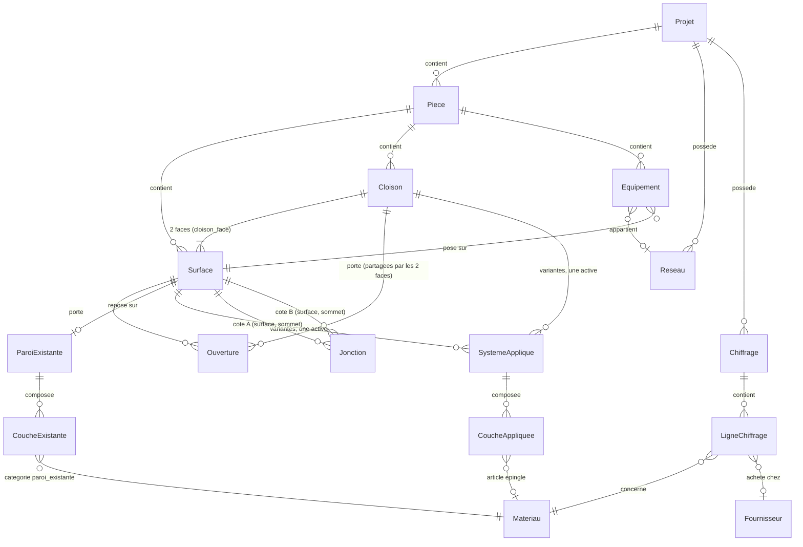

# Modèle de domaine

Base : MariaDB via Doctrine ORM (attributs PHP). Entités dans `src/Entity`, repositories dans
`src/Repository`. Valeurs géométriques en **millimètres entiers**. Le catalogue, les fournisseurs et les
prix sont détaillés dans [01-catalogue.DONE.md](01-catalogue.DONE.md) ; chiffrage et exports dans
[06-chiffrage-exports.DONE.md](06-chiffrage-exports.DONE.md).

## Entités

Une `Piece` porte aussi `formeSol` (JSON de sommets). `Surface` est une table unique : les faces de cloison
sont des lignes `type = cloison_face` avec `cloison_id` et `cote` renseignés.

| Entité | Champs principaux |
|---|---|
| `Projet` | id, nom, description, dateCreation, adresseChantier + latitude/longitude (optionnels), parametres JSON (marges de sécurité par catégorie ou matériau, options) |
| `Piece` | id, projet, nom, hauteurSousPlafond (mm, valeur par défaut pour créer des murs rectangulaires, pas une source de vérité), formeSol JSON `[{x,y}]` mm anti-horaire, sourceMesures (saisie, dxf, csv) |
| `Surface` | id, piece, type (`mur`, `plafond_pan`, `sol`, `cloison_face`), cloison (nullable, renseigné pour `cloison_face`), cote (`A` \| `B`, nullable), nom, origine3D, vecteurU, vecteurV (JSON d'**entiers non normalisés**, par exemple en millièmes ; la normalisation se fait à la lecture, aucun flottant persisté), polygone JSON `[{id,u,v}]` résolu (chaque sommet a un identifiant stable),  contraintes JSON (sommets placés par distance depuis un sommet ou par angle) ; mur, pan incliné et plafond horizontal sont le même objet, `type` est indicatif |
| `Jonction` | surfaceA, sommetDebutA, sommetFinA (portion de l'arête, identifiants de sommets stables), surfaceB, sommetDebutB, sommetFinB (ou portions en mm le long de l'arête pour les cloisons), type (`angle_saillant`, `angle_rentrant`, `faitage`, `noue`, `plat`, `cloison_sur_mur`, `cloison_sur_cloison`, `cloison_sur_doublage`, `cloison_sur_sol`, `cloison_sous_plafond`…) |
| `Cloison` | id, piece, nom, debut `{x,y}` mm, fin `{x,y}` mm (axe, modifiables), epaisseur mm (**dérivée** du système actif, jamais saisie), ancrageDebut, ancrageFin (type `mur` \| `cloison` \| `doublage` \| `libre`, cible, position le long de la cible), parametres JSON |
| Face de cloison | pas d'entité propre : ligne de `Surface` de type `cloison_face` (colonnes `cloison` et `cote`), polygone dérivé du tracé et du plafond |
| `Ouverture` | id, surface **ou** cloison, nom (optionnel), type, polygone JSON `[{u,v}]` (ou rectangle u,v,largeur,hauteur), typePose (`applique` \| `tunnel`), typeContour, refoncement (mm, profondeur du dormant en retrait du nu du mur ; ≥ 0), parametres JSON |
| `ParoiExistante` | surface (1–1), couches (matériau existant + épaisseur, ou R forfaitaire) |
| `SystemeApplique` | id, surface **ou** cloison (deux clés étrangères nullables, exactement une renseignée), variante (libellé), actif (bool), definitionSysteme (code), parametres JSON ; plusieurs par surface, **un seul actif** |
| `CoucheAppliquee` | systemeApplique, ordre, face (`null` = couche commune ; `A` \| `B` pour le parement d'une face de cloison), role (`attache`, `isolant`, `ossature`, `membrane`, `parement`…), emplacement (code dans la définition), specification JSON (catégorie + critères), materiau (nullable : article épinglé), orientation (degrés, nullable), position (`entre_ossature`, `continue`, `sur_ossature`), decalage JSON (calepinage), epaisseurOverride |
| `Materiau`, `Fournisseur`, `PrixMateriau` | voir `01-catalogue.DONE.md` |
| `Equipement` | id, piece, surface, famille (`electrique`, `plomberie`, `ventilation`), type, u, v (la hauteur sur un mur est `v`, pas de champ `hauteurPose`), reseau, parametres JSON |
| `Reseau` | id, projet, nom, famille, type, parametres JSON (section, protection, diamètre…) |
| `Chiffrage`, `LigneChiffrage` | voir `06-chiffrage-exports.DONE.md` |

Choix : les polygones sont stockés en **JSON** (petits, jamais interrogés en SQL), manipulés dans le code
par des objets valeur (`Polygone`, `Point2D`). Surface plane : un mur courbe n'est pas représentable
(décision : non pris en charge).

## Pièce, cloison et face

- Une **pièce** est un volume entouré de **murs physiques** ; ses murs viennent du polygone au sol. Ajouter une
  cloison **ne modifie pas** la pièce (pas de scission).
- Une **cloison** appartient à une pièce. Son système est un `SystemeApplique` rattaché à la cloison (pas à une
  face) ; les couches communes (ossature, isolant, attaches) ont `face = null`, les parements ont `face = A`
  ou `B`.
- Les **faces** sont créées et mises à jour à partir du tracé et du plafond : jamais saisies à la main ; leurs
  noms sont modifiables.
- Les **ouvertures** d'une cloison sont portées par la cloison (repère du tracé) et projetées sur les deux
  faces ; supprimer l'ouverture la retire des deux.
- Un **ancrage** désigne la structure qui reçoit l'extrémité : un mur (identifiant de `Surface` mur), une autre
  `Cloison`, un doublage (`Surface` portant un système de doublage) ou rien (`libre`).
- Supprimer une cloison supprime ses faces, ses ouvertures et son système ; les cloisons ancrées sur elle
  deviennent `libre` avec avertissement.

## Objets valeur (hors Doctrine)

`Point2D`, `Point3D`, `Polygone`, `Segment`, `Plan`, `Longueur` (mm), `Epaisseur`, `MaterielSpecification`
(rôle, catégorie, critères, valeurs tirées du contexte), `ContexteCouches` (épaisseur cumulée, profondeur de
cavité, direction de l'ossature, calepinage précédent, entraxe retenu, pas de vis par peau, pénétration
de vis), `ConfigurationOssature` (profilé, entraxe, renfort, zone d'application). Immuables, `readonly`.

`DefinitionSysteme` et `EmplacementCouche` ne sont pas des entités : ce sont des services/objets de code
enregistrés par tag (voir `05a-moteur-couches.DONE.md`).

## Migration depuis l'existant

- `Model\Mur` → hydraté depuis une `Surface` de type mur rectangulaire (largeur, hauteur) via un adaptateur
  pour que les calculateurs actuels continuent à fonctionner pendant la transition.
- Ouvertures : le tableau associatif devient `Ouverture` ; `distance_gauche`, `elevation`, `largeur`,
  `hauteur` correspondent à `u`, `v`, largeur, hauteur.
- Conversion m → mm à la lecture du formulaire existant.

## Règles de cohérence

- Le sol est une surface dérivée du polygone au sol, créée avec la pièce par `GenerateurSol` ; il porte jonctions et système comme les autres surfaces.
- Supprimer un projet supprime ses pièces, surfaces, ouvertures, équipements, chiffrages (cascade).
- Une ouverture reste dans sa surface (validation Symfony, voir `03-geometrie.DONE.md`).
- Une jonction relie deux arêtes (ou portions d'arêtes). Pour les jonctions entre surfaces de même contour (`angle_saillant`, `angle_rentrant`, `faitage`, `noue`, `plat`), les longueurs sont égales (± 1 mm). Les jonctions de cloison (`cloison_sur_*`) ne contraignent pas l'égalité des longueurs : la cloison s'appuie sur une portion de l'arête.
- Ajouter ou supprimer un sommet ne décale rien : les jonctions référencent des identifiants de sommets stables, pas des index.
- Une surface (ou une cloison, qui porte son propre système) a au plus un `SystemeApplique` actif.
- Le nombre de couches d'un emplacement respecte la cardinalité de la définition (`min`..`max`).
- `SystemeApplique.parametres` conserve les choix utilisateur de pose (entraxe imposé, renfort, zone) ;
  la configuration retenue par le calcul est copiée dans le résultat, jamais déduite après coup.
- Un `materiau` épinglé satisfait la `specification` de sa couche (sinon avertissement, pas blocage).
- Les chiffrages sont **immuables** une fois créés (instantané) : ils ne dépendent plus du catalogue.
- Migrations Doctrine versionnées ; aucune modification manuelle du schéma.

## Propriétaire (plus tard)

L'ajout de l'utilisateur ajoutera une clé étrangère `proprietaire` sur `Projet` ; pièces, surfaces et chiffrages y
sont rattachés par cascade. Le catalogue, les fournisseurs et les prix sont globaux, hors cascade : le
multi-utilisateur imposera alors de décider s'ils sont partagés ou propres à chaque compte (travail à prévoir à ce
moment-là). Aucune préparation dans les phases actuelles.

## Tests

Tests unitaires des objets valeur du domaine (conformément à `_conventions-qualite.md`, pas de test du
mapping Doctrine trivial). Un test d'intégration n'est écrit que pour une requête ou une logique propre au
projet (par exemple l'historique de prix ou la recherche de candidats du catalogue).
